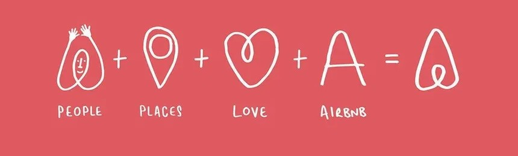

    
# 🏙️ Airbnb Booking Analysis  

<p align="center">
  
  
  <a href="https://airbnb-booking-analysisgit-cxrpaaqephwyjcdvyb5xrp.streamlit.app">
    
  </a>
</p>

---

## 📌 Project Overview  
This project analyzes **Airbnb listings in New York City** to understand how  
pricing varies across **boroughs and neighbourhoods**.  
The goal is to identify **affordable locations for travelers** and uncover  
**key factors influencing rental prices** using Exploratory Data Analysis (EDA).

🔗 GitHub Repo: [Link](https://github.com/pragya0405/airbnb-booking-analysis)
🌐 Live Demo: [Link](https://airbnb-booking-analysisgit-cxrpaaqephwyjcdvyb5xrp.streamlit.app)

---

## 🎯 Objectives  
- Analyze Airbnb pricing trends across NYC boroughs  
- Identify affordable neighbourhoods for budget travelers  
- Understand the relationship between price, availability, and reviews  
- Convert EDA insights into an **interactive Streamlit web app**

---

## 🧠 Key Insights  
- 🏙️ **Manhattan** has the highest average Airbnb prices  
- 💰 **Bronx & Queens** offer more affordable accommodation options  
- 📉 Price shows **weak correlation** with availability and number of reviews  
- 📍 **Location is the dominant factor** influencing Airbnb prices in NYC  

---

## 🖥️ Streamlit Web App  

🌐 **Live Demo:** [Click here to explore](https://airbnb-booking-analysisgit-cxrpaaqephwyjcdvyb5xrp.streamlit.app)

This project is also deployed as an **interactive Streamlit application**, allowing users to:
- Explore average prices by borough  
- Visualize correlations between numeric features  
- Interact with real Airbnb data dynamically  

> 📌 *Streamlit makes the analysis accessible to non-technical users.*

---

## 🛠️ Tech Stack & Skills  

### 💻 Programming & Libraries  
<p>
  
  
  
</p>

### 📊 Visualization  
<p>
  
  
</p>

### 🌐 Deployment  
<p>
  
</p>

---

## 📂 Project Structure  
```
Capstone-EDA-Airbnb-NYC
│
├── data/
│ └── Airbnb NYC 2019.csv
│
├── notebooks/
│ └── Airbnb_Analysis.ipynb
│
├── app.py
├── requirements.txt
└── README.md
```
---

## ▶️ How to Run Locally  

> 💡 **Prefer not to install?** Try the [Live Demo](https://airbnb-booking-analysisgit-cxrpaaqephwyjcdvyb5xrp.streamlit.app) directly.

### 1️⃣ Clone the repository  
```
git clone https://github.com/pragya0405/airbnb-booking-analysis.git
```
2️⃣ Install dependencies
```
pip install -r requirements.txt
```

3️⃣ Run Streamlit app
```
streamlit run app.py
```
---
## 🚀 Future Enhancements
- Add interactive filters (borough, price range)
- Include room type-based analysis
- Integrate map-based visualizations
---

## 📄 License
This project is licensed under the MIT License.

---

## 👨‍💻 Author

**Pragya**  
🚀 Data Analyst
<h3 align="center">📬 Let's Connect</h3>

<p align="center">
  <a href="https://github.com/pragya0405" target="_blank">💻 GitHub</a>
  &nbsp;•&nbsp;
  <a href="https://www.linkedin.com/in/pragya0405" target="_blank">💼 LinkedIn</a>
  &nbsp;•&nbsp;
  <a href="mailto:pragya.p0405@gmail.com">📧 Email</a>
</p>

